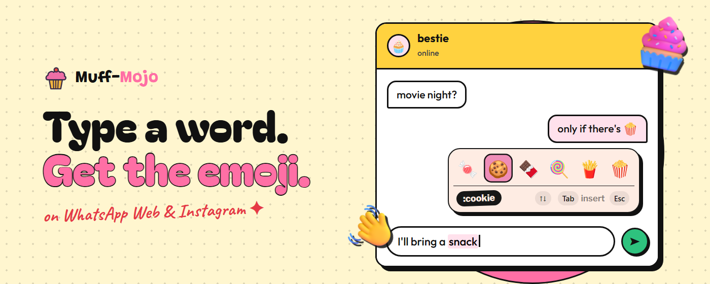
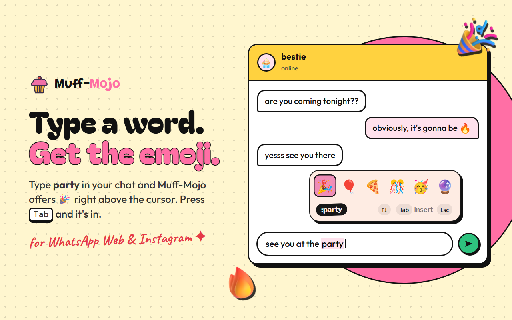
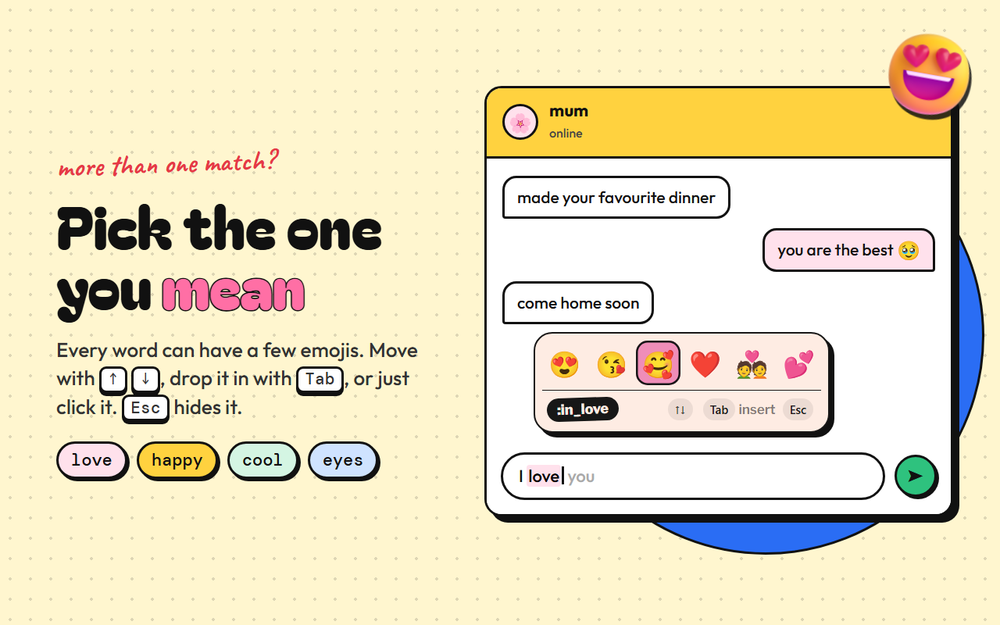
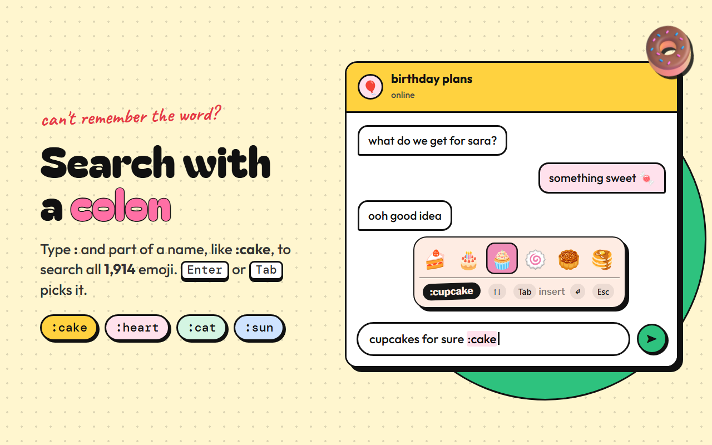
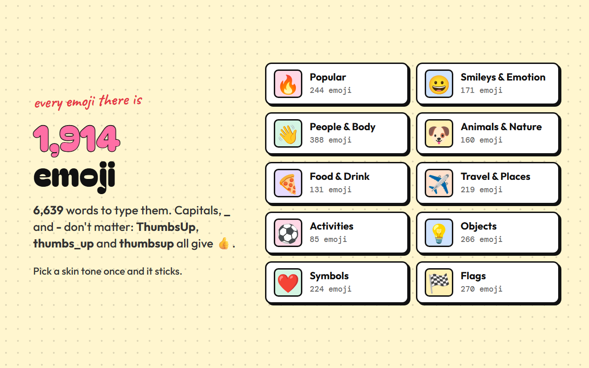
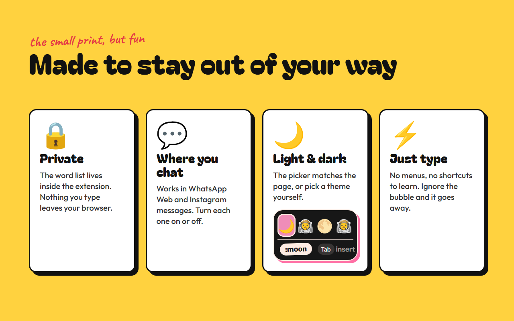
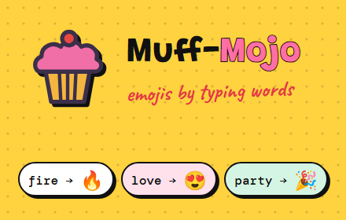

<p align="center">
  
</p>

<h1 align="center">Muff-Mojo 🧁</h1>

<p align="center">
  <b>Type a word. Get the emoji.</b><br />
  Emoji suggestions right above your cursor on WhatsApp Web &amp; Instagram.
</p>

<p align="center">
  <a href="https://chromewebstore.google.com/detail/pbngdkapkjlkimhjhbkdcfppegcknjke"></a>
  <a href="https://chromewebstore.google.com/detail/pbngdkapkjlkimhjhbkdcfppegcknjke/reviews"></a>
  <a href="https://chromewebstore.google.com/detail/pbngdkapkjlkimhjhbkdcfppegcknjke/reviews"></a>
  <a href="https://chromewebstore.google.com/detail/pbngdkapkjlkimhjhbkdcfppegcknjke"></a>
  <br />
  
  
</p>

<p align="center">
  <a href="https://chromewebstore.google.com/detail/pbngdkapkjlkimhjhbkdcfppegcknjke"><b>⬇️ Add to Chrome</b></a> &nbsp;·&nbsp;
  <a href="https://muffmojoweb.onrender.com/"><b>🌐 Website</b></a> &nbsp;·&nbsp;
  <a href="https://muffmojoweb.onrender.com/#playground"><b>🎮 Try it in the playground</b></a>
</p>

<p align="center">
  
</p>

---

## ✨ How it works



1. **Type a word** like `love`, `fire` or `pizza` in any chat box.
2. **Pick one** with <kbd>↑</kbd> <kbd>↓</kbd>.
3. **Press <kbd>Tab</kbd>** (or click) and the word turns into the emoji.

<kbd>Enter</kbd> still sends your message as usual, and <kbd>Esc</kbd> hides the picker for that word.

## 💕 More than one match? Pick the one you mean



Every word can have a few emojis, and the ones you've used recently move to the front.

## 🔍 Can't remember the word? Search with a colon



Type `:` and part of a name (`:cake`, `:hamsa`, `:japan`) to search everything. <kbd>Enter</kbd> or <kbd>Tab</kbd> picks it.

## 🌈 Every emoji there is



| | |
| --- | --- |
| 🔤 **1,914 emoji** | Everything up to Emoji 17, flags included |
| 🗝️ **6,639 trigger words** | `ThumbsUp`, `thumbs_up` and `thumbsup` all give 👍 |
| ✋ **Skin tones** | Pick one in Settings and it sticks |
| 🤫 **Quiet by default** | Everyday words like "like" or "time" don't pop the picker |

## 🔒 Made to stay out of your way



- **Private:** the word list lives inside the extension, and nothing you type leaves your browser. The only permission is `storage`, for your settings and recently used emojis.
- **Where you chat:** WhatsApp Web and Instagram DMs/comments, each one can be switched on or off.
- **Light &amp; dark:** the picker matches the page, or you choose.

## 🧁 The popup

Click the cupcake in your toolbar to:

- 🔎 **Browse and search** every emoji, see what to type, click to copy
- 🕘 See your **recently used** emojis
- ⚙️ Turn it off per site, use `:search` only, pick a theme or skin tone

---

## 📦 Install

**From the Chrome Web Store (recommended)**

[**⬇️ Add Muff-Mojo to Chrome**](https://chromewebstore.google.com/detail/pbngdkapkjlkimhjhbkdcfppegcknjke): one click and you're done.

> 🎮 **Want to try it first?** Play with the picker right in your browser on the
> [Muff-Mojo website](https://muffmojoweb.onrender.com/#playground), no install needed.

**From source (developer mode)**

1. Clone the repo:
   ```bash
   git clone https://github.com/owaismohammad/MuffMojo.git
   ```
2. Open `chrome://extensions` and switch on **Developer mode**.
3. Click **Load unpacked** and choose the `extension` folder inside `MuffMojo`.
4. Open WhatsApp Web or Instagram and start typing. 🎉

## 🛠️ For developers

<details>
<summary><b>Project layout</b></summary>

```
MuffMojo/
├── extension/                 🧁 everything Chrome loads (this is what you zip)
│   ├── manifest.json          MV3 manifest
│   ├── icons/                 toolbar icons (16 / 32 / 48 / 128)
│   ├── shared/
│   │   ├── emoji-data.js      every Unicode emoji (generated, don't edit by hand)
│   │   └── emojis.js          lookup, search and skin tones (used by content script + popup)
│   ├── content/
│   │   └── content.js         the in-chat suggestion picker
│   └── popup/
│       ├── popup.html         toolbar popup
│       ├── popup.css
│       ├── popup.js
│       └── theme-boot.js      applies the saved theme before first paint
│
├── tools/                     🛠️ build scripts (not shipped)
│   ├── build-emoji-data.mjs   regenerates extension/shared/emoji-data.js
│   ├── curated.json           hand-picked trigger words
│   └── vendor/                source emoji datasets (MIT)
│
├── dev/                       🧪 local test pages (serve the repo root, e.g. python -m http.server)
│   ├── playground.html        content script + popup on a plain page
│   └── lexical.html           same, with a real Lexical editor (what WhatsApp Web uses)
│
└── assets/                    🎨 artwork (not shipped)
    ├── brand/                 original logo art
    └── store/                 Chrome Web Store icon, promo tiles and screenshots
```

</details>

<details>
<summary><b>Adding or changing trigger words</b></summary>

`extension/shared/emoji-data.js` is generated from two MIT-licensed datasets in `tools/vendor/`
([unicode-emoji-json](https://github.com/muan/unicode-emoji-json) for names, categories and skin tones,
and [emojilib](https://github.com/muan/emojilib) for keywords), plus our own trigger words in `tools/curated.json`.

Add a line to `tools/curated.json` (first word = display name):

```json
["🧋", "boba", "bubble_tea", "milk_tea"]
```

Then rebuild:

```bash
node tools/build-emoji-data.mjs
```

To pick up a new Unicode release, replace the files in `tools/vendor/` with newer versions of those packages,
update the file names at the top of `tools/build-emoji-data.mjs`, and rebuild.

</details>

<details>
<summary><b>Packaging for the Chrome Web Store</b></summary>

Zip the **`extension/`** folder and upload that. Nothing outside it is needed.

```powershell
# Windows (built-in tar; Compress-Archive on PowerShell 5 writes backslash paths the store rejects)
tar.exe -a -c -f muff-mojo.zip -C extension *
```

```bash
# macOS / Linux
cd extension && zip -r ../muff-mojo.zip . && cd ..
```

Store graphics (icon, promo tiles, screenshots) are in `assets/store/`.

</details>

## 🆕 What's new in 3.0

- 🎨 Brand-new picker and popup, with light &amp; dark themes
- 💕 Several emojis per word, with keyboard navigation
- 🌍 All 1,914 Unicode emojis, flags and skin tones
- ✅ Emojis go in through the chat's own editor, so what you send is what you see (and undo works)
- 🐛 Fixed: text after the cursor vanishing when an emoji was inserted
- 🐛 Fixed: duplicate tooltips and double insertions after clicking around
- 🐛 Fixed: the ↑ key being blocked when no emoji was showing
- 🐛 Fixed: words overriding each other (`love`, `kiss`, `wave`, `moon`…)
- 🐛 Fixed: the tooltip landing in the wrong place after scrolling

---

<p align="center">
  <br />
  <sub>Made with 🍩 by <a href="https://owaismohammad.vercel.app/">owaismohammad</a> · <a href="https://muffmojoweb.onrender.com/">muffmojoweb.onrender.com</a></sub>
</p>
